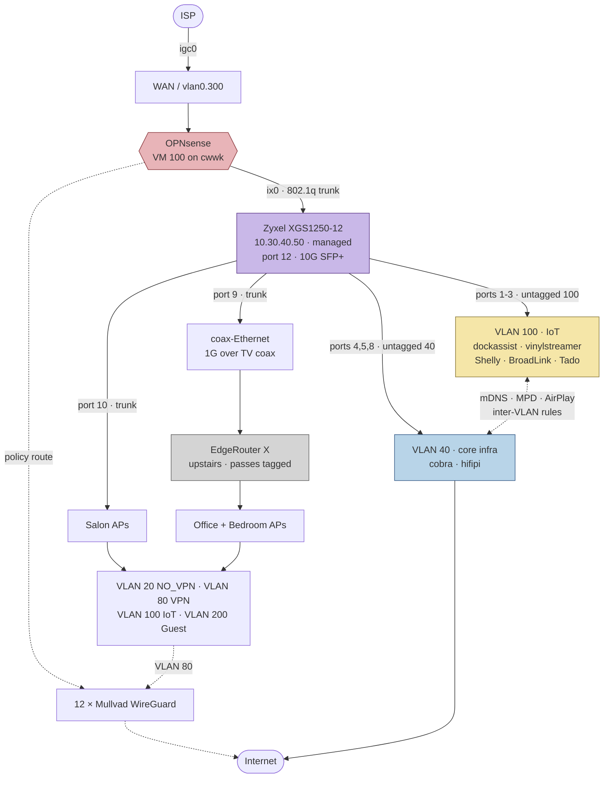

# Network Architecture

The layer that isn't in this repo.

Every other part of this infrastructure is reconstructible from Ansible: hosts,
roles, services, monitoring. The network is not. It lives entirely in
OPNsense's `/conf/config.xml` and the UniFi controller's database, and until this
document existed it was written down nowhere — six VLANs, thirteen WireGuard
tunnels and a policy-routed DNS exit that no file in this repository mentioned.

That is also why `docs/BACKUP_AND_RECOVERY.md` rates the OPNsense config as the
highest-risk artefact in the estate: losing it means rebuilding all of the below
by hand, from memory.

> **Sanitised on purpose.** This repository is public. WAN addressing, Mullvad
> endpoint IPs and every WireGuard public key are deliberately omitted. Only
> RFC1918 internals and design intent appear here. Do not paste raw
> `configctl wireguard showconf` or `config.xml` output into this file.
>
> 🔒 **Some detail was moved, not deleted** (2026-08-30). Wireless correlations —
> which SSID lands in which segment, and which one carries the weaker setting —
> now live in `docs/local/WIRELESS.md`, which is gitignored. Findings keep their
> mechanism and severity here; only the identifiers moved, and each redaction
> says so. The rule is [disclosure
> tiering](ARCHITECTURE_DECISIONS.md#disclosure-tiering--what-goes-in-a-public-repo);
> the reasoning is that SSID names are broadcast anyway, so the value an outsider
> gets is the correlation, not the name. **This narrows future exposure only —
> the earlier tables remain in git history.**

**Everything below was read from the live firewall and the live UniFi
controller**, not inferred, unless a line says otherwise — and where an earlier
inference turned out to be wrong, the correction is left in rather than edited
out. Probe commands are listed under
[Re-deriving this document](#re-deriving-this-document) and
[Reading the UniFi controller](#reading-the-unifi-controller), so this can be
checked rather than trusted.

## Contents

Sections `1.`–`13.` under *Confirmed drift and defects* are numbered findings — cite them by number.

- [Segmentation](#segmentation)
- [The circular dependency worth knowing](#the-circular-dependency-worth-knowing)
  - [When only OPNsense is down, go wired](#when-only-opnsense-is-down-go-wired)
- [VPN](#vpn)
  - [Outbound — Mullvad (12 tunnels)](#outbound--mullvad-12-tunnels)
  - [Failover — and what happens when a group runs out](#failover--and-what-happens-when-a-group-runs-out)
  - [Replacing a Mullvad peer (runbook)](#replacing-a-mullvad-peer-runbook)
  - [Inbound — wg1_server (road warrior)](#inbound--wg1_server-road-warrior)
- [DNS](#dns)
  - [Resolver chain, DHCP and local names (since 2026-11-13)](#resolver-chain-dhcp-and-local-names-since-2026-11-13)
  - [Unbound is fully recursive](#unbound-is-fully-recursive)
  - [A second Unbound on loopback — REMOVED 2026-11-20](#a-second-unbound-on-loopback--removed-2026-11-20)
  - [The firewall's own lookups go to 1.1.1.1](#the-firewalls-own-lookups-go-to-1111)
  - [Port 53 redirect](#port-53-redirect)
- [⚠️ Confirmed drift and defects](#-confirmed-drift-and-defects)
  - [1. wg9 (Mullvad US3) is dead, and Quad9 is routed through it — RESOLVED](#1-wg9-mullvad-us3-is-dead-and-quad9-is-routed-through-it--resolved)
  - [2. cwwk bypasses the estate resolver — RESOLVED](#2-cwwk-bypasses-the-estate-resolver--resolved)
  - [3. The DNS failover script's premise no longer holds](#3-the-dns-failover-scripts-premise-no-longer-holds)
  - [4. Two wg1 peers have never connected — RESOLVED](#4-two-wg1-peers-have-never-connected--resolved)
  - [5. One Ubiquiti device is a firmware generation behind — RETRACTED](#5-one-ubiquiti-device-is-a-firmware-generation-behind--retracted)
  - [6. Fleet name resolution has no fallback — RESOLVED](#6-fleet-name-resolution-has-no-fallback--resolved)
  - [7. Pi-hole-era naming outlived Pi-hole by nine months](#7-pi-hole-era-naming-outlived-pi-hole-by-nine-months)
  - [8. Two guest SSIDs share one VLAN with different isolation — 🔒 detail redacted](#8-two-guest-ssids-share-one-vlan-with-different-isolation---detail-redacted)
  - [9. One SSID has protected management frames disabled — 🔒 detail redacted](#9-one-ssid-has-protected-management-frames-disabled---detail-redacted)
  - [10. Switch port 1 is running at 10 Mbps half-duplex](#10-switch-port-1-is-running-at-10-mbps-half-duplex)
  - [11. Switch port 4 has a CRC error](#11-switch-port-4-has-a-crc-error)
  - [12. The switch configuration is not backed up](#12-the-switch-configuration-is-not-backed-up)
  - [13. The EdgeRouter X is unmanageable and unrecoverable](#13-the-edgerouter-x-is-unmanageable-and-unrecoverable)
- [Physical layer](#physical-layer)
  - [The backbone switch — Zyxel XGS1250-12](#the-backbone-switch--zyxel-xgs1250-12)
  - [Access points](#access-points)
  - [Wireless — SSID → VLAN](#wireless--ssid--vlan)
  - [Compute](#compute)
- [Where the fleet actually lives](#where-the-fleet-actually-lives)
  - [IoT devices (VLAN 100)](#iot-devices-vlan-100)
- [Name resolution: Dnsmasq names under `internal`](#name-resolution-dnsmasq-names-under-internal)
- [Reading the UniFi controller](#reading-the-unifi-controller)
- [Getting at the switch](#getting-at-the-switch)
- [The EdgeRouter X — a known unknown](#the-edgerouter-x--a-known-unknown)
  - [Four ways it was hunted, on 2026-08-07 — all negative](#four-ways-it-was-hunted-on-2026-08-07--all-negative)
  - [An unexplained observation](#an-unexplained-observation)
- [Validating a firewall upgrade](#validating-a-firewall-upgrade)
- [Re-deriving this document](#re-deriving-this-document)
- [Sources](#sources)

---


---

## Segmentation

Six VLANs trunked over a single SFP+ link (`ix0`), plus WAN on a separate copper
NIC (`igc0`). The firewall is the gateway for every segment and holds `.254` in
each.

| VLAN | Subnet | OPNsense descr | Purpose | Egress |
|-----:|--------|----------------|---------|--------|
| 20 | `10.30.20.0/24` | `VLAN20_NO_VPN` | Hosts that must **not** be tunnelled — anything geo-locked or VPN-hostile | WAN direct |
| 40 | `10.30.40.0/24` | `VLAN40_Native` | Core infrastructure services; **native VLAN for cabled hosts** | Mullvad — *corrected 2026-09-13: this row said WAN direct, but every VLAN 40 host checked (agent-lxc 2026-09-05, hifipi and cobra 2026-09-13) egressed via Mullvad*. **Exception:** hifipi egresses WAN direct via a floating policy rule, because Spotify refuses Mullvad exits (TODO 38) |
| 80 | `10.30.80.0/24` | `VLAN80_VPN` | WiFi clients that egress via VPN | Mullvad |
| 100 | `10.30.100.0/24` | `VLAN100_IoT` | IoT / home automation | — |
| 200 | `10.30.200.0/24` | `VLAN200_Guest` | Guest network | — |
| 300 | *(WAN)* | `ETH2_WAN` | Uplink, DHCP from ISP, on `igc0` | — |

VLAN 40 being the **native** VLAN is the detail that matters most for anything in
this repo: every Ansible-managed host, the Proxmox guests at `10.30.40.200–204`
and the test containers at `.205`/`.206` sit here, untagged.

An interface group **`Trusted_VLANs`** exists and is what most inter-VLAN rules
are written against, rather than listing segments individually.



Two things to carry from this diagram:

- **The Zyxel is the single point through which all wired traffic passes.** It is
  as load-bearing as OPNsense and, unlike OPNsense, its config is not backed up
  anywhere — see [finding 12](#12-the-switch-configuration-is-not-backed-up).
- **The Ansible-managed fleet spans VLAN 40 and VLAN 100.** The audio system and
  hostname resolution both depend on traffic crossing that boundary. See
  [Where the fleet actually lives](#where-the-fleet-actually-lives).

There are **three VLAN-aware devices** in series on the upstairs path — OPNsense,
the Zyxel, and the EdgeRouter X. Only the first two are documented here.

---

## The circular dependency worth knowing

OPNsense runs as **VM 100 on `cwwk`**, the Proxmox host — which sits on VLAN 40,
whose gateway is OPNsense. If `cwwk` goes down there is no internet and no
routing at all, and recovering it needs local console access, not the network.

This is already flagged in memory as *"cwwk = internet SPOF"* and has bitten
twice via fan-loss overheating (2026-06-30, 2026-07-31). It is a network fact as
much as a hardware one, which is why it is repeated here.

### When only OPNsense is down, go wired

OPNsense does the VLAN and Wi-Fi routing, so a **wireless** laptop loses `cwwk`
the moment the firewall is down — and with it `qm rollback 100`, the rollback for
OPNsense itself.

Wired does not depend on it. `cwwk` attaches to the managed switch over a 10G DAC
and the switch taps back into a `cwwk` ethernet port, so a laptop on a VLAN 40
port sits in `cwwk`'s L2 domain and needs no router at all.

Verified end to end 2026-08-19 with Wi-Fi off: with `cwwk` down the switch
configuration was still reachable, and with the OPNsense VM down Proxmox was
still reachable.

📌 **Do firewall maintenance from the wired path.** This is the case above's
escape hatch — it does not help if `cwwk` itself is down, which still needs a
console.

---

## VPN

### Outbound — Mullvad (12 tunnels)

Twelve Mullvad WireGuard tunnels, three per exit region, all sharing one client
address on the Mullvad side. Each has a matching outbound-NAT rule
(`NAT for WG_MULLVAD_GW_<REGION><n>`), so they are selectable exits rather than a
single always-on tunnel.

| Interface | OPNsense descr | Region | State |
|-----------|----------------|--------|-------|
| `wg0` | `wg0_mullvad_nl1` | NL | up — peer moved to `nl-ams-wg-301` on 2026-09-14 after its old relay went inactive ~2026-09-10 ([worked example](#replacing-a-mullvad-peer-runbook)) |
| `wg2` | `wg0_mullvad_nl2` | NL | up — peer `nl-ams-wg-303` (xtom), replacing the inactive `nl-ams-wg-002`; when it was swapped was not recorded (found 2026-11-15) |
| `wg3` | `wg0_mullvad_nl3` | NL | up — peer `nl-ams-wg-004` (31173) since 2026-11-15, after it was found with no peer and its gateway down; the old relay `nl-ams-wg-101` had left Mullvad's list by 2026-09-14 |
| `wg4` | `wg0_mullvad_es1` | ES | up |
| `wg5` | `wg0_mullvad_es2` | ES | up |
| `wg6` | `wg0_mullvad_es3` | ES | down from ~2026-11-17 until re-keyed 2026-11-20: Mullvad rotated `es-bcn-wg-101`'s public key and the peer kept the old one (found by the 26.7.9 upgrade diff) |
| `wg7` | `wg0_mullvad_us1` | US | up — peer `us-nyc-wg-001` |
| `wg8` | `wg0_mullvad_us2` | US | up — peer `us-nyc-wg-002` |
| `wg9` | `wg0_mullvad_us3` | US | up since 2026-11-20 — the tunnel handshook; its gateway was down because the monitor, Quad9 (`9.9.9.9`), stopped answering ICMP through the US exit. Monitor moved to h-root `198.97.190.53` ([finding 1](#1-wg9-mullvad-us3-is-dead-and-quad9-is-routed-through-it--resolved)) |
| `wg10` | `wg0_mullvad_uk1` | UK | up |
| `wg11` | `wg0_mullvad_uk2` | UK | up |
| `wg12` | `wg0_mullvad_uk3` | UK | up |

`wg0` carries by far the most traffic (multiple GiB), consistent with NL1 being
the default exit; the rest sit at tens of MiB, which is roughly keepalive-only.

The interface descriptions are all prefixed `wg0_` regardless of which interface
they are on — a copy-paste artefact from however they were created. Harmless, but
it makes them impossible to tell apart at a glance in the UI.

### Failover — and what happens when a group runs out

VLAN 40 and VLAN 80 are routed by one rule (*Route ext traffic through Mullvad NL
Failover*) to the gateway group `Mullvad_failover_nl`. Every group's tiers, read
from `config.xml` on 2026-11-20 (all trigger `downlosslatency`; the tier fields
are `item`, `item2` … `item5`):

| Group | Tier 1 | Tier 2 | Tier 3 | Tier 4 | Tier 5 |
|-------|--------|--------|--------|--------|--------|
| `Mullvad_failover_nl` | NL1 | NL2 | NL3 | UK3 | ES1 |
| `Mullvad_failover_es` | ES1 | ES2 | ES3 | NL1 | UK3 |
| `Mullvad_failover_us` | US1 | US2 | US3 | — | — |
| `Mullvad_failover_uk` | UK3 | UK1 | UK2 | — | — |

hifipi is the one exception: a floating rule, `from 10.30.40.100 to ! USED_LAN_NETS`
via the WAN gateway, loaded ahead of the group rule because Spotify refuses Mullvad
exits.

🔴 **If every member of the group is down, VLAN 40 and 80 go out the WAN,
unencrypted** — all five tiers, across three regions. `skip_rules_gw_down` is not set (read 2026-09-14), and OPNsense's
documented default is that *"when a rule has a specific gateway set, and this
gateway is down, rule is created and traffic is sent to default gateway."* The
documentation describes a single gateway; that a fully-down group behaves the same
is inferred, not tested.

**Decided 2026-11-20: that fallback is accepted, on condition that it pages** — no
kill switch. `check_wg.sh` on the firewall (every 10 min) judges each group the
way failover does, by gateway status: CRITICAL when a group has no usable member
("leaves via the WAN gateway, unencrypted"), WARNING for any single Mullvad
gateway down, saying whether its tunnel still handshakes (monitor fault) or not
(tunnel dead). Forced on the live firewall with the real status doctored, before
it was deployed. Until that date it counted handshaking tunnels against
thresholds written for four tunnels, so it stayed green until ten of twelve were
dead: ES3 was down three days unseen.

### Replacing a Mullvad peer (runbook)

**Manual on purpose.** It is a firewall change on the internet single point of
failure, and an automated swap that picks wrong takes two VLANs offline. What tells
you to run it is agent-lxc's relay signal (`mullvad_relay_signal.sh`): it alerts
`#home-alerts` when a relay a peer uses goes inactive, drops out of Mullvad's list,
publishes a public key other than the one pinned for its peer, or comes back, and
posts weekly reminders to `#home-logging` while it stays that way.

**A new public key is a one-field fix, not a swap.** Mullvad rotated
`es-bcn-wg-101`'s key around 2026-11-17 while the relay stayed active, and ES3 never
handshook again (0 B received). Set the peer's public key to the one in the alert,
then run steps 3–4 and 6; skip choosing a relay.

**Decide before touching anything.** Mullvad marks relays inactive for maintenance
as well as before retirement, and neither its relay API nor its servers page says
which. A relay down for a day may return; after 14 days the signal's reminder says
that permanence is now likely — as an inference, not a Mullvad statement. Replace a
peer when its group is short of healthy members, not on the first alert.

1. **Pick the relay.** Active relays for the region, with provider and public key:
   ```
   curl -s https://api.mullvad.net/app/v1/relays | python3 -c 'import json,sys; [print(r["hostname"], r["provider"], r["public_key"]) for r in json.load(sys.stdin)["wireguard"]["relays"] if r["hostname"].startswith("nl-ams-") and r["active"]]'
   ```
   Pick the fastest active relay. Provider diversity is **not** a goal here
   (decided 2026-11-20: NL1 and NL2 both on xtom is deliberate, for speed), and a
   working peer is never swapped just to mix providers.
2. **Replace the peer, not the tunnel.** *VPN → WireGuard → Peers*, edit the existing
   peer: endpoint `<hostname>.relays.mullvad.net`, port `51820`, the public key from
   step 1. Leave the instance, interface assignment, gateway, outbound-NAT rule and
   group membership untouched — a new tunnel means redoing all five. Deleting an
   instance **leaves its `wgN` interface behind**, up and unconfigured, until
   `ifconfig wgN destroy`.
3. **Re-apply routing.** Changing a peer does **not** re-add the gateway's routes. Run,
   as root, `/usr/local/etc/rc.routing_configure` (the gateway-apply path). Avoid
   `configctl interface reconfigure optN` for this: it also reloads DHCP and DNS.
4. **Verify on the firewall** (as root):
   ```
   route -n get <monitor IP>              # interface must be the tunnel (wgN), not vlan0.300
   wg show wgN latest-handshakes          # recent
   pluginctl -r return_gateways_status    # the gateway: status none, 0% loss
   pfctl -sr | grep route-to              # the VLAN 40/80 rule routes to the tier you expect
   ```
5. **Verify from the estate:** agent-lxc's exit
   (`curl -s https://am.i.mullvad.net/json` names the new relay), and Spotify from
   hifipi if its exception rule was touched.
6. **Update the repo:** regenerate `agent_mullvad_relays` in
   `ansible/inventory/group_vars/agent.yml` from the firewall's config, never by hand:
   `ssh opnsense 'sudo -n cat /conf/config.xml' | bin/mullvad-relays -` (or a backup
   `bin/opnsense-validate pre` wrote). It prints hostnames, public keys and labels
   only. Then deploy the agent role (`services.yml --limit agent-lxc --tags agent`,
   `--check` first). A relay changed on the firewall but not here is one the signal
   silently stops watching; a key changed without its pin keeps the alert standing.
7. **Update the table above.**

🔴 When reading `/conf/config.xml` from a shell, **whitelist the fields you print.** A
blacklist filter printed two WireGuard preshared keys into a session on 2026-09-13.

**Worked example — NL1, 2026-09-14.** `wg0`'s relay went inactive around 2026-09-10
and the group failed over to NL3, whose exit Spotify refused. The peer was moved to
`nl-ams-wg-301` (active, xtom). The tunnel handshook at once, yet dpinger showed NL1
**down at 100% loss**: its far-gateway (`10.64.0.1`) and monitor routes still pointed
at the WAN, so the monitor pinged from the tunnel address out the wrong interface.
Step 3 put both routes back on `wg0`. `wg13` was the leftover of a first attempt at
building a new tunnel instead (step 2).

### Inbound — `wg1_server` (road warrior)

`wg1` is the only tunnel that terminates *on* the firewall rather than leaving
it: a road-warrior server on `10.30.41.0/24`, firewall at `10.30.41.1`. In use
(confirmed 2026-11-20): an empty `latest-handshakes` across a few days is not a
reason to disable it.

| Peer address | State |
|--------------|-------|
| `10.30.41.5` | active — handshaking, ~1 GiB in / 3.2 GiB sent |
| `10.30.41.7` | configured, idle by design (0 B received as of 2026-09) |
| `10.30.41.8` | configured, idle by design (0 B received as of 2026-09) |

✏️ *2026-11-15:* `wg show wg1` lists **four** peers, not three; none had
handshaken since the firewall's last boot (2026-11-12). Which device the fourth
is was not established.

All three use preshared keys in addition to the peer key. The two idle peers
were identified on 2026-11-01 as Ignacio's own devices, kept for occasional
remote access; which device is which is in `docs/local/`. Idle is not a fault
here. Lose one of those devices and its peer gets removed — that, not
inactivity, is when a peer becomes a standing credential.

---

## DNS

Unbound on OPNsense is the resolver for the whole estate, since Pi-hole was
retired in **November 2025** (`pihole-lxc`, CT 102, still present commented-out in
`ansible/inventory/hosts.yml` with `archived_reason`).

Relevant rules, by description:

- `All hosts to Pihole DNS`
- `Allow Pihole DNS failover to public servers`
- `Allow DNS queries to Unbound`
- `TEST - Block VPN resolver`

Three of those four still name Pi-hole nine months after it was decommissioned,
and one is explicitly labelled `TEST`. The rules are almost certainly doing
something useful — but what they are *called* no longer describes the estate,
which is exactly the trap this document exists to prevent.

### Resolver chain, DHCP and local names (since 2026-11-13)

```
client ──DHCP──▶ Dnsmasq (OPNsense)   lease: address, router, DNS 10.30.40.254, domain `internal`
client ──DNS───▶ Unbound 10.30.40.254
                   ├─ `internal` + 10.30.{20,40,80,100,200} reverse zones ──▶ Dnsmasq 127.0.0.1:53053
                   └─ everything else ──▶ recursive from the root servers
```

- **DHCP is Dnsmasq** on VLANs 20/40/80/100/200, migrated from ISC on 2026-11-13.
  Pools, 24 h leases and the DNS option (Unbound only) were carried over
  unchanged; the old `local` search domain was dropped for `internal`. Why
  Dnsmasq and not Kea: [decision](ARCHITECTURE_DECISIONS.md#dns-architecture-updated-november-2025).
- **Local names live only in Dnsmasq**, under `internal`, with PTRs. Dynamic
  clients are registered from their DHCP hostname; the static-address hosts
  (cwwk, the LXCs, the switch, the firewall) resolve too. `opnsense.internal`
  answers with its VLAN 40 address only.
- **Unbound stays the resolver for every client** and forwards the local zones
  to Dnsmasq on `127.0.0.1:53053`. ✏️ *Corrected 2026-11-15: this said Dnsmasq
  listens on loopback only.* It binds `*:53053`, and a client querying a VLAN
  gateway on 53053 gets local names back; external names are `REFUSED`
  (`no-resolv`, no `server=`), so there is no path around Unbound or its
  blocklist. `bin/opnsense-validate` records both answers (`B.dnsmasq.from_client`).
- **The legacy Unbound host overrides** (`<host>.local`, A only, no PTR) are
  being retired. Nothing in this repo uses them since `fleet_dns_domain:
  internal`; the Pis never reached them anyway, because libnss-mdns answers
  `.local` from multicast with `[NOTFOUND=return]`.

Verified 2026-11-15: a VLAN 80 lease carries `domain_name internal`, DNS
`10.30.40.254` and a 86400 s lease; all fleet names resolve as `<host>.internal`
via 10.30.40.254, with PTRs on VLAN 40 and VLAN 100. The Dnsmasq side (port,
loopback bind, per-VLAN ranges) was read by the OPNsense session, not re-read here.

### Unbound is fully recursive

> ✏️ **Corrected 2026-11-13:** still true for the internet, but no longer for
> the local zones — Unbound now forwards `internal` and the fleet's reverse
> zones to Dnsmasq ([above](#resolver-chain-dhcp-and-local-names-since-2026-11-13)).
> The rest of this section is the 2026-08-07 reading.
>
> ✏️ **Corrected again 2026-11-15: no longer true for the internet either.**
> `/var/unbound/etc/dot.conf` forwards `.` to the in-tunnel Mullvad resolvers
> `10.64.0.1`, `.3`, `.7` and `.11`, which route over `wg0`, `wg3`, `wg7` and
> `wg11`. **`10.64.0.3` routed into `wg3`, which had no peer**, so one upstream
> in four was a dead end, until NL3 was re-peered later that day. When the forward was configured is not known. The
> 2026-09-20 decision entry ("VPN-first DNS — superseded, was never live")
> describes the box before this change.

Verified on the live box: `/var/unbound/` contains **no `forward-zone` and no
`forward-addr` anywhere**. `etc/dot.conf` and `etc/domainoverrides.conf` are both
empty, and `unbound.conf` loads `root-hints`. Unbound resolves from the root
servers itself; it does not forward to anything.

This matters because `scripts/services/opnsense/monitor_dns_failover.sh` opens by
describing a different architecture:

```
#   Layer 1: Unbound forwards to 4 Mullvad DNS servers (10.64.0.1, .3, .7, .11)
#            Each routes through different tunnel - automatic failover
#   Layer 2: This script - if ALL tunnels down, switch to Cloudflare
```

Layer 1 is not what is running. See
[the failover script's premise](#3-the-dns-failover-scripts-premise-no-longer-holds).

### ~~A second Unbound on loopback~~ — REMOVED 2026-11-20

> Removed with `sysrc -x unbound_enable` and a `TERM` to the stock instance's pid
> (its own pidfile, `/usr/local/etc/unbound/unbound.pid`; OPNsense's is
> `/var/run/unbound.pid` and it never reads the rc variable). Afterwards only
> OPNsense's instance listens on `:53`, and `127.0.0.1` and `cobra.internal`
> resolve. The previous `rc.conf` was left at `/tmp/rc.conf.before-20261120`.
> Not yet seen across a reboot: the next `bin/opnsense-validate` run shows
> `A.unbound.instances` with one entry. The original finding follows.


`/etc/rc.conf` carries `unbound_enable="YES"` (file dated 2025-11-16), so
FreeBSD's stock Unbound starts at boot with the package's sample config
(`/usr/local/etc/unbound/unbound.conf`) next to OPNsense's own
(`/var/unbound/unbound.conf`), and holds `127.0.0.1:53` and `[::1]:53`. Found
2026-11-15.

Measured the same day: 30 of 30 queries to `127.0.0.1` were counted by
OPNsense's instance (`unbound-control -c /var/unbound/unbound.conf
stats_noreset`), so `heartbeat_dns.sh` and `check_dns_health.sh`, which probe
`@127.0.0.1`, reach the resolver they mean to. Re-measured 2026-11-20, after the
26.7.9 upgrade and its reboot: the stock instance came back, and 30 queries to
`127.0.0.1` were again all counted by OPNsense's (32, with background traffic).
`bin/opnsense-validate` records both instances (`A.unbound.instances`), so a
change shows up in the diff. Nothing was changed.

### The firewall's own lookups go to `1.1.1.1`

`/etc/resolv.conf` on the firewall is `nameserver 1.1.1.1` (read 2026-11-20): the
firewall's own lookups (packages, ddclient, CrowdSec, the peers' relay hostnames)
go to Cloudflare out the WAN, not through Unbound or Mullvad. Plausibly
deliberate — the peer endpoints are hostnames that must resolve before any
tunnel is up — but not recorded as a decision anywhere.

### Port 53 redirect

OPNsense transparently redirects outbound port 53 to Unbound, so clients cannot
bypass it by hardcoding a public resolver. `tests/cases/health_no_internet.sh`
depends on this behaviour.

Note the redirect catches **DNS only**. It does not affect ICMP or other traffic
to the same address, which is what made the Quad9 finding below need care.

---

## ⚠️ Confirmed drift and defects

Found while deriving this document, on **2026-08-07**. None of these were known
before; none are fixed. Each was verified on the live firewall, not inferred.

### 1. ~~`wg9` (Mullvad US3) is dead, and Quad9 is routed through it~~ — RESOLVED

> **Resolved 2026-11-20.** By then the tunnel itself was fine: `wg9` handshook
> every two minutes and received traffic, and a DNS query to `9.9.9.9` *through
> `wg9`* answered in 78 ms. Only ICMP to Quad9 failed, so dpinger, which pings
> its monitor, held the gateway down. The `9.9.9.9` host route below was that
> monitor's route. The monitor is now h-root, `198.97.190.53` (10/10 replies;
> g-root `192.112.36.4` dropped every ping), completing the set: the other
> eleven gateways monitor root servers a–f and i–m. Monitors must be unique per
> gateway, and each gets a host route through its tunnel, so a root server is
> the right kind: nothing here queries one directly, since Unbound forwards
> everything to Mullvad. The old `9.9.9.9 → wg9` route outlived the change in
> the routing table (no static route in `config.xml`); it clears at the next
> reboot or routing reconfigure. `wg9` is tier 3 of `Mullvad_failover_us`.
> The text below is the 2026-08-07 finding as written.

`wg9` has a peer configured and is sending — **15.42 MiB out, 0 B in, no
handshake ever recorded**. The tunnel has never come up.

A static route pins `9.9.9.9` to `wg9`:

```
9.9.9.9   10.64.0.9   UGHS   wg9
```

So Quad9 is unreachable from the firewall, confirmed by ping:

```
9.9.9.9 → 2 packets transmitted, 0 received, 100.0% packet loss
1.1.1.1 → 2 packets transmitted, 2 received, 0.0% packet loss
```

**The blast radius is narrow — and an earlier draft of this document got it
wrong.** The static route applies only to traffic *originating on the firewall*.
Forwarded LAN traffic follows per-rule policy routing instead, which overrides the
routing table in pf. Verified from `cwwk`:

```
ping 9.9.9.9   → 2 transmitted, 2 received, 0% loss
getent hosts deb.debian.org (via 9.9.9.9) → resolves
```

So LAN clients reach Quad9 normally. Only the firewall itself cannot.

Nothing currently depends on that: Unbound is
[fully recursive](#unbound-is-fully-recursive) and never queries Quad9, and both
DNS monitoring scripts deliberately use `1.1.1.1` as their fallback, commented
*"no VPN route, uses default gateway"* — the author knew to avoid the
VPN-routed resolver.

What remains is genuine but lower-severity: **a dead tunnel and a static route
pointing into it**, plus a stale Unbound override naming the retired Pi-hole:

```
local-data: "pihole.local  IN A 9.9.9.9"
local-data-ptr: "9.9.9.9 pihole.local"
```

No host in the repo or the fleet references `pihole.local` — grepped the repo and
checked `/etc/resolv.conf` across five hosts. It is dead config, not a live trap.

*Still not verified:* whether `wg9` belongs to a gateway group where its deadness
would degrade failover for other traffic. That needs `config.xml`, which
`read_agent` cannot read.

### 2. ~~`cwwk` bypasses the estate resolver~~ — RESOLVED

✅ **Fixed 2026-11-15.** `ansible/playbooks/platform/proxmox.yml` now owns
cwwk's `/etc/resolv.conf`: `search internal`, `nameserver 10.30.40.254`. Before
switching, Unbound was queried from cwwk for fleet names and the Debian/Proxmox
repositories; all answered.

**Why the public resolver went, and why no fallback replaced it.** Quad9 was put
there deliberately, to keep the hypervisor out of a circular dependency on the
firewall it hosts. Checked on cwwk 2026-11-15, that circle does not run through
`resolv.conf`:

- **The circle that matters is the node's own name.** pve-cluster will not start
  if the hostname does not resolve, and then no guest autostarts — VM 100
  included. cwwk resolves its own name from `/etc/hosts` (`getent hosts cwwk` →
  `10.30.40.51`), so starting the firewall needs no DNS at all. Nothing else
  checked in the boot path names a host: no `.internal` in
  `/etc/pve/storage.cfg`, `/etc/fstab` or the chrony config.
- **With OPNsense down, Quad9 is unreachable anyway.** The default route is
  `10.30.40.254`. DNS errors on cwwk while the firewall is down or booting are a
  symptom of having no internet, not of a loop, and clear when it comes up.
- **The one case a public second resolver covers** — OPNsense routing but
  Unbound broken — is already paged: `heartbeat_dns.sh` pings healthchecks.io only
  when `drill @127.0.0.1` answers, so a dead Unbound alerts from outside. Adding
  Quad9 as a fallback would instead break that incident further: glibc moves on
  only after a timeout (5 s per lookup), and `internal` names would come back
  NXDOMAIN from a third party.

Every `resolv.conf` entry must give the same answers; a public resolver cannot
answer `internal`, so it is not a fallback for this one.

The original finding, as read on 2026-08-07 (its "oversight" reading was wrong —
corrected above):

The hypervisor's `/etc/resolv.conf` is `nameserver 9.9.9.9` — every other host
checked (`cobra`, `hifipi`, `dockassist`, `unifi`) points at `10.30.40.254`.

DNS works there today (Quad9 is reachable from the LAN, per above), so this is
not an outage. But it means the single most critical host in the estate — the one
whose failure takes the internet down with it — resolves names via a third party
instead of the resolver the rest of the fleet uses, and gets none of Unbound's
local overrides. It also looks like an oversight rather than a decision: `9.9.9.9`
is the default upstream baked into the **archived** Pi-hole role
(`ansible/roles/services/pihole/`), which is where the address entered this estate.

### 3. The DNS failover script's premise no longer holds

`scripts/services/opnsense/monitor_dns_failover.sh` is running and healthy — its
state file reads `healthy|0|9359|vpn`, i.e. **9359 consecutive successful checks**
in `vpn` mode. Its health probe is sound: it independently queries the four
Mullvad resolvers with `drill` and they answer.

But its *premise* and its *remediation* both target a configuration that is not
in use. The script exists to switch Unbound's forwarder to Cloudflare when all
tunnels drop — and Unbound has no forwarder to switch, because it resolves
recursively from root hints.

**Why this is the dangerous kind of stale:** the script reports healthy and will
keep reporting healthy. Nothing about its output reveals that its Layer 2
protection is aimed at a setting that isn't there. It is green because its
probe passes, not because the protection works.

The good news is that the protection is also no longer *needed* in its original
form — recursive Unbound does not depend on the Mullvad tunnels for resolution,
so tunnels dropping should not break DNS at all. That makes this a cleanup, not
an outage risk.

*Not verified:* what the script actually does to `config.xml` if it ever fires,
and whether that would newly *introduce* forwarding. Testing it means taking all
twelve tunnels down, which is not something to do casually. **Read the script's
`switch_to_fallback` path before trusting either outcome.**

### 4. ~~Two `wg1` peers have never connected~~ — RESOLVED

`10.30.41.7` and `10.30.41.8` are Ignacio's own devices, kept on purpose for
occasional remote access (identified 2026-11-01). See
[Inbound — wg1_server](#inbound--wg1_server-road-warrior).

### 5. ~~One Ubiquiti device is a firmware generation behind~~ — RETRACTED

Withdrawn once the controller was readable. `10.30.40.3` is a **different model**
(U7 Lite) on its own firmware line, running `6.8.2` — *newer* than the other
three at `6.7.54`. The older dropbear banner reflects the model's own release
train, not a missed update. See the correction note under
[Access points](#access-points).

### 6. ~~Fleet name resolution has no fallback~~ — RESOLVED

✅ **Resolved 2026-11-13** by Dnsmasq: every fleet host has an `internal` name
and PTR in DNS, so resolution no longer rests on mDNS crossing VLANs. See
[Name resolution](#name-resolution-dnsmasq-names-under-internal). The original
finding:

Covered in the 2026-08-07 reading of name resolution, kept below.
Unbound serves the estate's recursive DNS but holds no records for the estate's
own hosts, so Ansible reachability rests entirely on mDNS crossing VLAN 40↔100.
Adding host overrides in Unbound for the seven fleet hosts would cost minutes and
remove the dependency — **not done, proposed only.**

### 7. Pi-hole-era naming outlived Pi-hole by nine months

Three firewall rules and one Unbound override still refer to a host retired in
November 2025, and one rule is labelled `TEST`. Nothing is known to be broken by
this; the risk is that the next person to read those rules — human or agent —
believes them.

---

### 8. Two guest SSIDs share one VLAN with different isolation — 🔒 detail redacted

Two SSIDs sit on the **same guest VLAN** with **different L2-isolation
settings**. Because they share a broadcast domain, the isolation on the stricter
one is only as strong as the looser one: a client on the unisolated SSID is not
prevented from reaching clients on the isolated one.

⚠️ **Reasoned from the configuration, not tested.** Confirming it means
associating a device to each SSID and attempting traffic between them. Worth
doing before deciding whether this matters — the intent behind two guest SSIDs
isn't recorded anywhere, and one is named for a specific person, which suggests
it was set up deliberately for someone.

Which SSID is which is in `docs/local/WIRELESS.md`, per the [disclosure tiering
rule](ARCHITECTURE_DECISIONS.md#disclosure-tiering--what-goes-in-a-public-repo).

### 9. One SSID has protected management frames disabled — 🔒 detail redacted

Exactly one of the five SSIDs runs `pmf_mode=disabled`; the other four are
`optional`. Without 802.11w, management frames are unauthenticated and clients
can be deauthenticated by anyone in range — the classic precondition for
forced-reassociation and handshake-capture attacks.

🔴 **The severity is not reduced by the redaction.** The affected SSID fronts the
segment carrying the Shelly plugs, the BroadLink IR blasters and the Tado bridge
— **heating and mains power**. This is the weakest wireless setting in the estate
sitting in front of its most physically consequential devices.

✅ **Confirmed deliberate, and confirmed final (2026-09-02).** The operator tested
it: these devices **cannot associate with PMF enabled**. Raising it does not harden
the segment, it removes it — the heating and the mains plugs go offline. So this is
an **accepted trade-off, not a misconfiguration and not a pending task**. The
standing rule is [PMF on the IoT SSID is refused, not
pending](ARCHITECTURE_DECISIONS.md#wireless--pmf-on-the-iot-ssid-is-refused-not-pending).
🔴 **Do not re-open it on the grounds that the weakness is still present** — that is
true, and it was weighed.

🔒 **Which SSID it is, is in `docs/local/WIRELESS.md`.** The segment is named
above because it is already documented throughout this file; the SSID name is
what turns "some IoT segment" into "associate to *this* one". Redacting the name
was never the fix and does not pretend to be one — `pmf_mode` is
advertised in the beacon's RSN capabilities, so anyone in RF range reads it off
the air. What redaction removes is the *remote* shortcut: knowing from GitHub,
without ever being nearby, which SSID to go and stand next to. **Enabling PMF would have been the
actual fix — and it is ruled out**, because the devices cannot associate with it.
What redaction buys here is therefore the whole of what is available: the weakness
itself is accepted.

### 10. Switch port 1 is running at 10 Mbps half-duplex

Every other live port on the Zyxel is `1G-Full`. **Port 1 is `10M-Half`** — two
orders of magnitude down, and half-duplex, which means collisions and
retransmits. It is not idle: 600 K packets out, 203 K in.

Port 1 is `PVID 100`, so whatever is on it is an **IoT-VLAN device**.

Three plausible causes, in order of likelihood: a damaged or non-8-conductor
cable (a break in the pairs used for gigabit will fall back exactly like this), a
failing port or NIC, or a genuinely 10 Mbps device. **Swapping the cable is the
one-minute test** — if it comes up at 1G, that was it.

**The operator expects it to be either the TV or the Tado hub** — both IoT-VLAN
devices, consistent with `gi1`'s PVID 100. That narrows it usefully, and it makes
a bad cable *more* likely rather than less:

- Neither device is 10 Mbps-only. Both are at worst 10/100, and a healthy 10/100
  device negotiates **100-Full**, not 10-Half.
- **10-Half is the classic autonegotiation-failure signature.** It is what a link
  falls back to when the negotiation cannot complete — most often because the
  cable does not have all four pairs intact, or a connector is marginal.

So the reading is: this is probably not "an old device being old", it is a link
that failed to negotiate. Swap the cable first. If the device is the **Tado hub**,
note that it is the bridge for the heating system, and the estate's Tado
automation (`tado_presence.sh` on `dockassist`) reaches it over this segment.

⚠️ *Still not formally established* — the switch UI shows link state, not device
identity, and nothing readable maps ports to devices.

### 11. Switch port 4 has a CRC error

One. Not zero. Every other port is clean, and this counter is cumulative over
163 hours of uptime, so it is a single event rather than a pattern.

Not actionable on its own — but CRC errors come from physical-layer problems, and
a cable that produces one will usually produce more. Worth re-reading the counter
in a few weeks: still `1` means noise, climbing means a cable to replace.

### 12. The switch configuration is not backed up

`docs/BACKUP_AND_RECOVERY.md` covers OPNsense, Home Assistant, Plex, Proxmox and
UniFi. It does not cover the Zyxel, whose UI has a
**Configuration Restore/Backup** function producing a config file.

That config is the entire VLAN and PVID map — the thing that decides which
physical port lands in which network. Losing it means re-deriving the port map by
hand, which is precisely the situation this document was written to prevent, and
the switch is a single unit with no redundancy.

✅ **Resolved 2026-08-07.** The decoded config is committed at
**`docs/reference/zyxel-xgs1250-12.cfg`** with the credential line redacted, and
`docs/BACKUP_AND_RECOVERY.md` carries the refresh and recovery procedure.

Committed as **plain text, not vaulted**, on purpose: what remains after
redaction is the VLAN and PVID map, which is already published in this document.
Keeping it readable means `git diff` shows a port changing VLAN — a vaulted blob
would hide precisely the change worth noticing. The one genuinely sensitive line
(`username "admin" secret 8 $8$…`) is stripped, and is not worth backing up
anyway, since restoring onto a factory-reset switch means setting a new password.

Related, lower severity: **HTTP is enabled alongside HTTPS** on the management
interface (`ip http session-timeout 15` sits beside its HTTPS twin in the
config). Management is at least confined to VLAN 40 rather than VLAN 1, which is
the more important half of that decision.

Also visible and worth an eye rather than an action: `spanning-tree mst
configuration` carries a region name that is just the switch's own MAC — the
default. With one switch and no loops that is inert. It would start to matter if
the downstream **EdgeRouter X** speaks MST, since two devices in different MST
regions do not form a common topology. *Not investigated* — the EdgeRouter has
never been probed.

### 13. The EdgeRouter X is unmanageable and unrecoverable

Management access was lost years ago when it was switched into managed-switch
mode. It carries every VLAN to two of the four APs, its firmware version and
patch state are unknown, and there is **no saved configuration** to restore onto
a replacement — because nobody can read the one it is running.

It works today. It is simply the element with the worst failure story: if it
dies, upstairs wireless dies with it and the rebuild starts from scratch.

Full detail, and three ways in, under
[The EdgeRouter X — a known unknown](#the-edgerouter-x--a-known-unknown).

---

## Physical layer

Read from the UniFi controller API (`unifi-lxc`, CT 101, `10.30.40.201:8443`)
using a read-only account, and cross-checked against the firewall's ARP table.

### The backbone switch — Zyxel XGS1250-12

**Every wired host in the estate connects to this switch.** It is a *managed*
switch at `10.30.40.50`, and it does the 802.1Q work: OPNsense trunks all VLANs
to it over 10G, and it hands each host an untagged port in the right VLAN.

| | |
|---|---|
| Model / firmware | XGS1250-12 · `V2.00(ABWE.1)C0` |
| Address | `10.30.40.50/24`, gateway `10.30.40.254`, **static** (DHCP client disabled) |
| Management VLAN | **40** — not VLAN 1 |
| Uptime at capture | 163 h |
| Management | HTTPS **and HTTP** both enabled, 15-min timeout |

> Sourced from the switch's web UI and its exported `startupconfig.cfg`, both
> supplied by the operator on 2026-08-07. `read_agent` has no access to it — see
> [Getting at the switch](#getting-at-the-switch).

#### The exported config is obfuscated, not encrypted

`startupconfig.cfg` looks like binary. It is the plaintext running-config
**XOR'd with the single byte `0xa5`**:

```bash
python3 -c "import sys;d=open(sys.argv[1],'rb').read();\
sys.stdout.write(bytes(b^0xa5 for b in d).decode())" startupconfig.cfg
```

🔑 **This matters for how the backup is stored.** The file is not protected in
any meaningful sense, and it contains the **admin password hash** —
`username "admin" secret 8 $8$…`. Anyone holding the file holds the switch's
credential material. A backup of this file therefore belongs in **`vault.yml`
(encrypted), never committed in the clear**, and never pasted into an issue,
a chat or this document.

Two things the config settles that were previously marked unverified:

- **There is exactly one account, `admin`.** No user list, no roles. A
  "read-only credential" for this switch **does not exist** — any stored
  credential is a full admin credential.
- **There is no SNMP.** Not a single `snmp-server` line, matching the operator's
  own testing. Two independent sources agree, so treat automated polling of this
  switch as unavailable rather than undiscovered.

#### Port map

`U:` = untagged/access, `T:` = tagged/trunk. Traffic counters are cumulative
since last clear, and are the strongest available hint at what is on each port.

The UI numbers ports 1–12; the config names them `gi1`–`gi8` (1 G copper) and
`te1`–`te4` (10 G). **UI port 9 is `te1`, 10 is `te2`, 11 is `te3`, 12 is `te4`.**

| UI | Config | Link | PVID | VLAN membership | TX / RX pkts | Role |
|---:|--------|------|-----:|-----------------|--------------|------|
| 1 | `gi1` | 🔴 **10M-Half** | 100 | untagged 100 only | 600 K / 203 K | IoT access — **degraded, [finding 10](#10-switch-port-1-is-running-at-10-mbps-half-duplex)** |
| 2 | `gi2` | 1G-Full | 100 | untagged 100 only | **63 M / 74 M** | IoT access, busiest access port |
| 3 | `gi3` | Down | 100 | untagged 100 only | 0 | spare IoT access |
| 4 | `gi4` | 1G-Full | 40 | untagged 40 only | 1.9 M / 3.7 M | VLAN 40 access · ⚠️ 1 CRC error |
| 5 | `gi5` | 1G-Full | 40 | untagged 40 only | 1.2 M / 446 K | VLAN 40 access |
| 6 | `gi6` | Down | 40 | untagged 40 + tagged 20/80/100/200 | 0 | spare hybrid trunk |
| 7 | `gi7` | Down | 40 | untagged 40 + tagged 20/80/100/200 | 0 | spare hybrid trunk |
| 8 | `gi8` | 1G-Full | 40 | untagged 40 only | 3.5 M / 1.6 M | VLAN 40 access |
| 9 | `te1` | 1G-Full | 40 | untagged 40 + tagged 20/80/100/200 | 2.2 M / 1.3 M | **coax backbone → upstairs** · ⭐ speed **forced** 1000/full |
| 10 | `te2` | 1G-Full | 40 | untagged 40 + tagged 20/80/100/200 | 8.5 M / 13 M | AP trunk |
| 11 | `te3` | Down | 40 | untagged 40 + tagged 20/80/100/200 | 0 | spare hybrid trunk |
| 12 | `te4` | **10G-Full** | 1 | **tagged only**, all VLANs | **90 M / 72 M** | 🔗 **SFP+ trunk to OPNsense's `ix0`** |

⚠️ **`te4` goes to OPNsense, not to `cwwk` as such.** Both NICs are on the same
physical CWWK board, but they are different ports with different treatment:
OPNsense's `ix0` is passed through to the VM and lands on the tagged trunk, while
`cwwk`'s own management NIC (`enp2s0`, `10.30.40.51`) sits on a plain
**untagged VLAN 40 access port** — one of `gi4`/`gi5`/`gi8`. Verified from
`/etc/network/interfaces`: `vmbr0` is a non-VLAN-aware bridge over `enp2s0`,
which is also why Proxmox guests only ever see untagged VLAN 40.

Four things worth reading off this:

- **`te1` is the only port with a hardcoded `speed 1000` / `duplex full`.** Every
  other port autonegotiates. That is exactly what you would do for a media
  converter that negotiates badly — and it **confirms the coax run is on UI port
  9**, which had been operator recollection until now.
- **VLAN 40 is tagged on the uplink and untagged everywhere else.** Hosts are
  genuinely untagged, so the "native VLAN" description holds from their point of
  view, while `te4` carries 40 tagged like any other VLAN. `te4` has no PVID line
  and no untagged VLAN, so it is a pure tagged trunk and stray untagged frames
  land in unused VLAN 1. That is the correct way round.
- **The trunk ports are hybrid, not pure.** `gi6`, `gi7`, `te1`, `te2`, `te3` all
  carry untagged VLAN 40 *plus* tagged 20/80/100/200 — so an AP or downstream
  device gets its management on untagged 40 and its SSIDs on tags. Three of the
  five (`gi6`, `gi7`, `te3`) are unused: spare capacity, already configured.
- **Three of the four 10 G ports are not doing 10 G.** `te4` is the only one at
  10G-Full. `te1` is pinned to 1 G by design, `te2` serves a 1 G AP, `te3` is
  dark. Not a problem — just worth knowing the headroom is there.

#### The upstairs run

Port 9 leaves the cabinet over a **coax-to-Ethernet adapter**, using the house TV
coax to carry 1G upstairs. Upstairs it lands in an **EdgeRouter X**, which exists
specifically to pass tagged traffic onward — which is why port 9 is a trunk and
not an access port. The office and main-bedroom APs hang off that EdgeRouter.

⚠️ **Operator-supplied and not yet confirmed on the hardware** — the port number
in particular. Everything else in the port map is read from the switch UI. The
EdgeRouter X itself is **not** in this document: it has not been probed, its
config is unknown, and it is a third VLAN-aware device in the path after
OPNsense and the Zyxel.

### Access points

**All four Ubiquiti devices are access points**, trunked off the Zyxel — two in
the cabinet's reach, two upstairs behind the coax run and the EdgeRouter.

| Name | Address | Model | Firmware | Uplink |
|------|---------|-------|----------|--------|
| `U6-Lite-Office` | `10.30.40.2` | U6 Lite | `6.7.54.15663` | **wired root**, 1 Gbps |
| `U6+-Salon-TV` | `10.30.40.1` | U6+ | `6.7.54.15663` | wired ← `U6-Lite-Office` port 1, 1 Gbps |
| `U6-Lite-Salon-Relay` | `10.30.40.4` | U6 Lite | `6.7.54.15663` | ⚠️ **wireless mesh** ← `U6+-Salon-TV`, RSSI 18 |
| `UAP-AC-Lite-Habitacion` | `10.30.40.3` | U7 Lite | `6.8.2.15592` | ⚠️ **wireless mesh** ← `U6-Lite-Office`, RSSI 23 |

All four adopted, all `state=1` (connected).

**Two of the four are wireless-meshed, not wired** — `Salon-Relay` (the name says
so) and `Habitacion`. Every client on those two APs has its traffic relayed over
the air before it reaches the wired network. The reported mesh RSSI values, 18
and 23, are the two lowest link metrics in the estate. *This document does not
assert a pass/fail threshold for them* — UniFi's mesh RSSI scale is not a plain
dBm figure and I could not verify how it maps. They are recorded because they are
the only wireless links carrying infrastructure traffic.

> **Corrections.** Two earlier claims in this document were wrong, both from
> inferring hardware from network-level evidence:
>
> - *"Two switches and two access points"*, inferred from open ports. All four
>   are APs. And `10.30.40.3` was flagged as a *firmware generation behind*
>   because its dropbear banner was older (`2024.86` vs `2025.89`) — it is a
>   different model (U7 Lite) on its own firmware line, running `6.8.2`, which is
>   *newer*. Version strings are not comparable across models.
> - *"The cabinet switch is an unmanaged Zyxel"* — **it is managed**, it is the
>   backbone every wired host connects to, and it carries the entire VLAN
>   configuration above. It never appeared in the firewall's ARP table (it was
>   simply not ARP-active during the sweep) and it is not adopted into UniFi, so
>   both of my discovery methods missed it completely.
>
> The lesson generalises: **ARP is not an inventory.** A device that isn't
> talking during the sweep does not exist as far as `arp -an` is concerned, and
> the most important switch in the estate is exactly the kind of device that sits
> quiet.

### Wireless — SSID → VLAN

🔒 **The per-SSID mapping is redacted from this file.** Five SSIDs exist, each
bound to a network in the controller, covering the VPN, no-VPN, IoT and guest
segments. The SSID→VLAN→isolation→PMF table lives in `docs/local/WIRELESS.md`
(gitignored) under the [disclosure tiering
rule](ARCHITECTURE_DECISIONS.md#disclosure-tiering--what-goes-in-a-public-repo):
the names are broadcast in every beacon, but which one lands in which segment,
and which one has a weaker setting, is not discoverable without being on the
network — and that correlation is the useful half.

What *is* worth publishing is the design intent, because it is the part that
catches people out:

- **All five are WPA2-PSK. None uses WPA3.** A deliberate compatibility choice,
  not an oversight.
- **None is configured as a UniFi "guest" network** (`is_guest=false`
  throughout) — guest treatment comes entirely from OPNsense's VLAN 200 rules,
  not from the controller's guest-control features. So the guest posture is a
  firewall property, and reading the controller alone will mislead you.
- **The default SSID egresses through Mullvad; the opt-out is a separate SSID.**
  Ordinary Wi-Fi traffic is tunnelled by default and you join a different SSID
  to bypass it. That is the inverse of the usual arrangement and worth knowing
  before debugging anything that looks geo-blocked.
- **Two SSIDs share the guest VLAN with different L2-isolation settings** — so
  the isolation on the stricter one is only as strong as the looser one beside
  it. Reasoned from config, not tested. Detail in `docs/local/WIRELESS.md`.

### Compute

`cwwk` (`10.30.40.51`) and `opnsense` (`10.30.40.254`) share a vendor OUI
(*Changwang Technology* — the CWWK board) with **adjacent MAC addresses**,
confirming the OPNsense VM is running on a NIC of the same physical mini-PC that
hosts it. That is the [circular dependency](#the-circular-dependency-worth-knowing)
visible at the hardware level.

---

## Where the fleet actually lives

**This is the finding most likely to catch out anyone working in this repo.**
`AGENTS.md` presents the seven hosts as one flat fleet. They are not — they
straddle two VLANs:

| Host | Address | VLAN | Hardware (OUI) |
|------|---------|------|----------------|
| `opnsense` | `10.30.40.254` | 40 | Changwang (CWWK board) |
| `cwwk` / `proxmox` | `10.30.40.51` | 40 | Changwang |
| `hifipi` | `10.30.40.100` | 40 | Raspberry Pi |
| `cobra` | `10.30.40.204` | 40 | Raspberry Pi |
| `unifi-lxc` | `10.30.40.201` | 40 | Proxmox virtual |
| `agent-lxc` | `10.30.40.203` | 40 | Proxmox virtual |
| **`dockassist`** | **`10.30.100.100`** | **100 — IoT** | Raspberry Pi |
| **`vinylstreamer`** | **`10.30.100.110`** | **100 — IoT** | Raspberry Pi |

🔴 **The VLAN 100 gateway `10.30.100.254` does not answer ICMP *from inside
VLAN 100*. It does answer from other VLANs.** This is a deliberate firewall
policy, not a fault — the IoT VLAN is kept as restricted as possible, and hosts
on it are not given a pingable gateway.

Measured 2026-08-24, both directions:

| Probing from | Result |
|---|---|
| `dockassist` — **VLAN 100 (IoT)** | **0/3, 100% loss** |
| `cobra` — VLAN 40 | 3/3, 0.24 ms |
| `hifipi` — VLAN 40 | 3/3, 0.26 ms |

⚠️ **The asymmetry is the trap.** Testing from VLAN 40 shows a healthy,
responsive gateway, so a reachability check written or verified from there looks
perfectly sound — and then never passes once it runs on an IoT host. That is
exactly what happened: `wifi_reconnect.sh` gated its health on pinging this
gateway and, on vinylstreamer, reloaded the wifi driver every two minutes
against a perfectly healthy radio until the host fell over.

**So for anything running ON VLAN 100:** never use the gateway as a reachability
probe. Prefer a **local** signal (NetworkManager device state, presence of a
route). If a peer probe is genuinely needed, `10.30.100.100` (dockassist) and
`10.30.100.217` (the vinylstreamer Shelly plug) were both verified to answer
from within the VLAN.

📌 **Could be relaxed.** Allowing ICMP to the gateway from VLAN 100 is a
risk/benefit call that has not been made, not a constraint to design around
forever. If it is ever enabled, note that it would make the gateway a valid
probe target and this warning would need revisiting — but the local-signal
preference above stands regardless, since it does not depend on the firewall.

Home Assistant and the vinyl streamer live on the **IoT** VLAN, not with the rest
of the infrastructure. That is a sensible placement — both talk constantly to IoT
devices — but nothing in the repo says so, and it has two consequences:

1. **The audio chain crosses a VLAN boundary.** `docs/AUDIO_AUTOMATION.md`
   describes `vinylstreamer` → `hifipi` streaming and `dockassist` orchestrating
   both. That path runs VLAN 100 → VLAN 40 and only works because of the
   explicit inter-VLAN rules named *"Allow MPD between all VLANs for audio
   streaming"*, *"AirPlay…"* and *"Spotify Connect communication"*. Those rules
   are not optional conveniences — the audio system depends on them.
2. **`from="10.30.0.0/16"` in the agent keys still covers both**, since it is a
   `/16` spanning every VLAN. Worth knowing that this is why it was scoped that
   way (`docs/AGENT_ACCESS.md` notes the laptop has no fixed IP).

### IoT devices (VLAN 100)

Thirteen devices, identified by vendor. Every one maps onto something already
documented elsewhere in this repo:

| Vendor (OUI) | Count | Almost certainly |
|--------------|------:|------------------|
| Espressif | 5 | Shelly devices — amp plug, Duo G3 bulbs, gas sensor |
| Hangzhou BroadLink | 2 | RM4 IR blasters (`docs/AUDIO_AUTOMATION.md`) |
| tado GmbH | 1 | Tado heating bridge |
| Raspberry Pi | 2 | `dockassist`, `vinylstreamer` |
| Apple | 1 | — |
| *(other)* | 2 | — |

VLAN 80 (WiFi VPN) held a single client at probe time, using a **randomised
MAC** (locally-administered bit set) — i.e. a phone or laptop with iOS/macOS
private WiFi addressing on.

---

## Name resolution: Dnsmasq names under `internal`

**Since 2026-11-13 fleet names are DNS names.** Dnsmasq registers them under
`internal` and Unbound serves them to everyone
([chain](#resolver-chain-dhcp-and-local-names-since-2026-11-13)). How each kind
of host gets there, measured 2026-11-15:

| Hosts | Search domain | `.local` goes to | Bare `cobra` resolves as |
|---|---|---|---|
| Laptop (macOS, DHCP) | `internal` | mDNS only | `cobra.internal` |
| Pis — cobra, hifipi, vinylstreamer, dockassist | `internal` | mDNS (`mdns4_minimal [NOTFOUND=return]`) | `cobra.internal` |
| cwwk (static, Ansible-managed `resolv.conf`) | `internal` | DNS | `cobra.internal` |
| LXCs — CT 101/103/104 (`pct` `searchdomain`, reconciled by `platform/proxmox.yml`; applied at container start) | `internal` | DNS | `cobra.internal` |
| Docker containers on dockassist | stale `local` until restarted | DNS | `cobra.local` (nothing uses bare names there) |

The agent on agent-lxc dials fully qualified `<host>.internal` names and pins
host keys with `HostKeyAlias`, so it depends on neither search domains nor mDNS.
The firewall rule *"Allow mDNS/Bonjour between all VLANs"* is no longer
load-bearing for Ansible; it still is for AirPlay and HomeKit discovery.

The 2026-08-07 reading, superseded but kept:

Unbound has **no A records and no PTR records for any fleet host**. Verified:

```
dig +short cobra @10.30.40.254   → (empty)
host 10.30.40.204                → NXDOMAIN
```

Yet `ssh cobra` works, because macOS resolves it over **mDNS/Bonjour**:

```
dscacheutil -q host -a name cobra.local → 10.30.40.204
```

This makes the firewall rule *"Allow mDNS/Bonjour between all VLANs"*
**load-bearing for Ansible itself**, not just for AirPlay discovery. The
inventory addresses hosts by name; the `-agent` SSH alias resolves them through a
`ProxyCommand` running `nc <hostname> <port>` on the Mac. If mDNS stops crossing
VLANs, every playbook targeting `dockassist` or `vinylstreamer` — the two hosts
on the far side of that boundary — fails to resolve.

Two hosts are already pinned to literal addresses rather than names:
`agent-lxc` (`10.30.40.203`, with a comment explaining the static assignment) and
the test containers (`.205`/`.206`). Those are immune. The rest are not.

---

## Reading the UniFi controller

Two paths were tried. **The database is not reachable; the API is.**

Closed — do not retry:

- `read_agent` on `unifi` has **no MongoDB client**. `/usr/lib/unifi/bin/mongod`
  is a symlink to the *server* binary, and no `mongo`/`mongosh` exists on the box.
- The controller's `mongod` binds `127.0.0.1:27117`, so it is unreachable from
  off-host anyway.

Works — a **read-only controller account** against the standalone controller's
REST API. Log in once to get a session cookie, then GET:

```bash
curl -sk -c /tmp/unifi.cookies -X POST "https://10.30.40.201:8443/api/login" \
     -H "Content-Type: application/json" \
     -d "{\"username\":\"read_agent\",\"password\":\"$UNIFI_PASS\"}"

BASE="https://10.30.40.201:8443/api/s/default"
curl -sk -b /tmp/unifi.cookies "$BASE/stat/device"       # APs: model, firmware, uplink
curl -sk -b /tmp/unifi.cookies "$BASE/rest/networkconf"  # networks → VLAN → subnet
curl -sk -b /tmp/unifi.cookies "$BASE/rest/wlanconf"     # SSIDs → network, security
curl -sk -b /tmp/unifi.cookies "$BASE/stat/sta"          # associated clients
```

The account's View Only role is enforced server-side: the session cookie carries
those permissions, so `POST`s that would change configuration are rejected by the
controller rather than by convention.

🔑 **The credential is in the vault** as `vault_unifi_readonly_user` /
`vault_unifi_readonly_password` (`3132f9a`). Rotating it was declined on
2026-10-31 (read-only, LAN-only, only ever shared in a local session; see
TODO.md), then done on 2026-11-13 anyway: UniFi OS Server refuses a password
without an uppercase letter (PER-127). Its only consumer is `bin/unifi-state`
on the laptop, the preflight included; no host or cron holds it. Pass it on stdin or via an environment variable, never inline in a
script, a cron entry or a committed file. `bin/unifi-state` is the worked
example: it reads the vault and hands the login to the host over ssh stdin
(PER-128; the before/after check in
[the unifi role's README](../ansible/roles/services/unifi/README.md)).

*Corrected 2026-11-10: this paragraph still said the password was outside the
repo and due for rotation after both had been settled.*

---

## Getting at the switch

The Zyxel is **not reachable by any automated path today**. It is not in UniFi,
it has no SSH, and `read_agent` has no credentials for it. Everything in
[the port map](#port-map) came from screenshots of its web UI.

That is the largest remaining hole in this document, because the switch decides
which physical port lands in which VLAN — and because its config is the one piece
of estate-critical state with no backup at all.

**Two of the three obvious options are now ruled out by the config itself**, not
by guesswork:

- ~~Read-only credentials~~ — **impossible.** One account, `admin`, no roles.
- ~~SNMP polling~~ — **not supported.** No `snmp-server` lines, and the operator
  had already tested this independently.

What remains:

1. **Periodic manual export**, stored **encrypted in `vault.yml`**. Solves
   [finding 12](#12-the-switch-configuration-is-not-backed-up), needs no new
   access, and is the only option with no downside. Do this.
2. **Scripted HTTP scrape with the admin credential.** Technically possible — the
   UI is plain HTTP/HTTPS — but it means storing an admin password to read link
   state. **Not recommended**: it trades a real credential for a nice-to-have,
   on the one device that can partition the whole LAN if it is misconfigured.
3. **Detect the symptom from elsewhere.** A port dropping to 10M-Half shows up as
   throughput collapse on the *host* behind it, and hosts are already monitored.
   An `ethtool`-based speed check in the existing monitoring would catch
   [finding 10](#10-switch-port-1-is-running-at-10-mbps-half-duplex) on any Linux
   host **without touching the switch at all**.

**Recommendation: do 1 now, and consider 3 as the real fix.** A link silently
falling to 10 Mbps is precisely the "nothing tells you a host needs attention"
class already raised in the handover — and option 3 addresses it from the side
of the estate that is already instrumented, rather than by adding admin
credentials to a switch with no read-only mode.

---

## The EdgeRouter X — a known unknown

Upstairs, behind the coax run, sits an **EdgeRouter X** configured in switch
mode so it can pass tagged VLANs to the office and bedroom APs. It is the third
VLAN-aware device in the path, after OPNsense and the Zyxel.

**Its management access was lost years ago.** Per the operator: once it was put
into managed-switch mode, its management address stopped being reachable and was
never recovered. It has worked ever since, so it was left alone.

That leaves a device which:

- carries **every VLAN** to two of the four access points,
- cannot be inspected, reconfigured or firmware-updated,
- has an **unknown firmware version**, therefore an unknown patch state,
- and would have to be **factory-reset to regain control**, which drops the
  upstairs APs until it is reconfigured.

Nothing here is on fire — it is passing traffic correctly today. But it is the
single least recoverable element of the network: if it fails, the upstairs
wireless goes with it and there is no saved configuration to restore onto a
replacement, because nobody can read the current one.

### Four ways it was hunted, on 2026-08-07 — all negative

Recorded so nobody repeats them. Run from CT 199 (`10.30.40.205`, VLAN 40) and
from `dockassist` (VLAN 100):

| Method | Result |
|--------|--------|
| Full ping/ARP sweep of `10.30.40.0/24` | 12 devices, **all identified** — no unknown host |
| Secondary IP `192.168.1.250/24` + sweep of `192.168.1.0/24` | **nothing responded** |
| LLDP neighbour tables from all four APs | APs see **only each other** — no switch, no router |
| Ubiquiti discovery broadcast, UDP 10001, from **two** VLANs | only the two U6 Lite APs answered |
| Ubiquiti discovery on VLANs **20, 80, 100 and 200**, from OPNsense | **zero responders** |

The LLDP result is the informative one. The two wired APs report each other as
directly-connected neighbours on `eth0`, even though the path between them runs
through the coax converters, the ERX **and** the Zyxel. So every device on that
path is **flooding LLDP rather than participating in it** — consistent with
consumer switching gear in transparent mode.

The Ubiquiti-discovery result is the strongest negative: EdgeOS normally answers
that probe. It did not, from either VLAN.

**Conclusion: the ERX has no reachable management interface on any segment
tested.** It is behaving as a pure transparent L2 bridge. That is consistent with
the operator's account — configuring switch mode left it with no addressable
management interface, and nothing since has been able to find one.

**Every VLAN has now been covered.** The tagged-VLAN probe was run from OPNsense,
which holds an interface on all of them, and returned **zero responders** on 20,
80, 100 and 200. Combined with the VLAN 40 sweeps, there is no segment left where
a discovery-speaking Ubiquiti device could be hiding.

*(Note on method: the container could not do this. `cwwk`'s `vmbr0` is a plain,
non-VLAN-aware bridge on `enp2s0`, so guests only ever see untagged VLAN 40.
OPNsense was the only available vantage point with all VLANs terminated.)*

**What is left to try:**

1. **Serial console.** The ERX has a physical console port. With every network
   approach exhausted, this is now the only reliable route in.
2. **Factory reset and reconfigure.** Regains control at the cost of dropping
   upstairs wireless until it is set up again. Only worth it alongside option 1
   failing, or a decision to replace the device.
3. **Accept and document.** Record the model and a rebuild plan so a failure
   means "configure a spare from notes" rather than "work out what it did".

⚠️ The negative results are solid; the *explanation* is inference. What is
verified is that **five discovery methods across every VLAN found nothing** —
not that no management interface exists at all. A device answering only on a
non-broadcast protocol, or with discovery services disabled, would look
identical.

### An unexplained observation

Ubiquiti discovery reports both U6 Lite APs as model `UFP-UAP-B`,
`Unifi-Protect-UAP-Bridge`, firmware `UFP-UAP-B.MT7621.v1.1.0.4…260513.1827`.
The Network controller reports the same two devices as `UAL6` / U6 Lite on
firmware `6.7.54.15663`. The two views disagree on both model and version
scheme, and the other two APs did not answer discovery at all.

**No conclusion is drawn from this.** It may be a platform-identifier quirk of
this model's discovery response, or a parsing artefact. The controller is
authoritative for adopted state, and it shows both APs healthy and serving SSIDs.
Noted only so it is not rediscovered as a surprise.

---

## Validating a firewall upgrade

```bash
bin/opnsense-validate pre     # before: baseline + /conf/config.xml backup
bin/opnsense-validate post    # after: same checks, diffed against the latest pre
```

Read-only, run from the laptop (one Touch ID for `ssh opnsense`). About 220
checks across platform, DHCP, DNS, egress and fleet. Each records command,
observed, expected and PASS/FAIL/INFO. The verdict is a **behaviour diff**:
`post` lists every check whose status or normalised value changed. Volatile
values are excluded (the list is in the script's header). Results and the
config backup go to `~/validation/`, mode 600, never to the repo: they hold
MACs, and the backup holds keys. The diff and parsers are forced both ways in
`tests/unit/opnsense_validate_test.sh`.

## Re-deriving this document

The network is not Ansible-managed, so this file **will** drift. It is checkable:

```bash
# Interfaces, VLANs and their addressing
ssh opnsense-agent "ifconfig -l; ifconfig | grep -E '^[a-z0-9_.]+:|vlan:|inet '"

# Routing table and default gateway
ssh opnsense-agent "netstat -rn -f inet"

# Tunnel health — one line per tunnel, UP or DEAD
ssh opnsense-agent "sudo configctl wireguard showconf | awk '/^interface:/{i=\$2} \
  /latest handshake:/{h[i]=\"UP\"} /transfer:/{t[i]=\$0} \
  END{for(k in t) printf \"%-6s %-4s %s\n\", k, (h[k]?h[k]:\"DEAD\"), t[k]}' | sort"

# Firewall rule count
ssh opnsense-agent "sudo pfctl -s rules | wc -l"   # 131 as of 2026-08-07
```

Interface descriptions, NAT rules and rule names come from `/conf/config.xml`,
which `read_agent` **cannot** read — it is root-only and not in the sudo
allowlist. That part needs an interactive session:

```bash
ssh opnsense "sudo grep -E '<descr>|<if>|<ipaddr>' /conf/config.xml"
```

**Do not generate repeated failed authentication against the firewall.** That is
what fed CrowdSec into banning `agent-lxc` on 2026-08-03.

---

## Sources

| Section | Derived from | Verified |
|---------|--------------|----------|
| VLAN subnets, interfaces | `ifconfig`, live | 2026-08-07 |
| VLAN purposes | Operator (Ignacio), plus `<descr>` in `config.xml` | 2026-08-07 |
| Tunnel inventory + health | `configctl wireguard showconf`, live | 2026-08-07 |
| Routing, Quad9 blackhole | `netstat -rn`, `ping`, live | 2026-08-07 |
| DNS overrides | `/var/unbound/host_entries.conf`, live | 2026-08-07 |
| Rule names | `config.xml` via operator session | 2026-08-07 |
| Device inventory, VLAN placement | `arp -an` on opnsense, live | 2026-08-07 |
| Vendor identification | OUI lookup against local `nmap-mac-prefixes` | 2026-08-07 |
| APs: model, firmware, mesh uplinks | UniFi controller API, live | 2026-08-07 |
| SSID→VLAN, WLAN security settings | UniFi controller API, live | 2026-08-07 |
| mDNS dependency | `dig` vs `dscacheutil`, live | 2026-08-07 |
| Dnsmasq names, PTRs, lease options | `dig` via 10.30.40.254, `ipconfig getpacket`, live | 2026-11-15 |
| Per-host search domain + nsswitch | `/etc/resolv.conf`, `/etc/nsswitch.conf` on every host, live | 2026-11-15 |
| Dnsmasq port, bind, ranges | OPNsense session (not re-read here) | 2026-11-15 |
| Guest-SSID isolation gap (finding 8) | **reasoned from config, not tested** | — |
| Switch port state, link speeds, counters | Zyxel web UI, operator screenshots | 2026-08-07 |
| Switch VLAN/PVID map, accounts, no-SNMP | decoded `startupconfig.cfg` | 2026-08-07 |
| Coax run on UI port 9 (`te1`) | **confirmed** — only port with forced speed | 2026-08-07 |
| Which device is on which switch port | **not established** — counters only hint | — |
| EdgeRouter X unreachable on VLAN 40 + 100 | 4 discovery methods, 2 vantage points | 2026-08-07 |
| EdgeRouter X — config, firmware, MST behaviour | **unknown; no access found** | — |
| VLAN 40 host inventory (12 devices, all named) | ping/ARP sweep from CT 199 | 2026-08-07 |

MAC addresses are deliberately not listed; vendor OUIs and roles are enough to
work with and do not fingerprint individual devices in a public repository.
